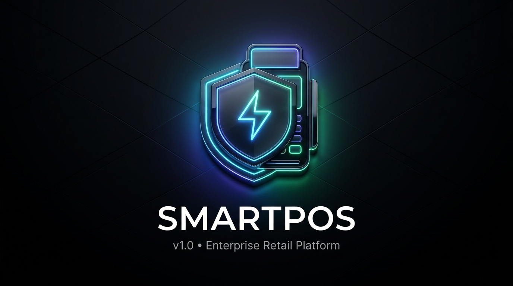

<p align="center">
  
</p>

<h1 align="center">SMARTPOS ENTERPRISE</h1>

<p align="center">
  <strong>Multi-Tenant SaaS Point of Sale &amp; Business Management Platform</strong><br>
  <em>"One Platform. Multiple Businesses. Complete Business Control."</em>
</p>

<p align="center">
  
  
  
  
  
  
</p>

---

## 📌 Executive Summary

**SMARTPOS ENTERPRISE** is a commercial-grade, multi-tenant SaaS Point of Sale (POS) and retail enterprise operating system. Multiple independent retail companies can register, choose subscription plans, operate multiple branches and checkout counters, manage inventory and warehouses, process sales, and track financial performance through a centralized web application.

Engineered with clean architectural discipline, strict logical database partitioning via EF Core global query filters, claims-verified tenant resolution, and zero trust on client-supplied tenant identifiers.

---

## 🏛️ Multi-Tenant Architecture & Security

```
┌────────────────────────────────────────────────────────────────────────┐
│                        WEB PRESENTATION LAYER                          │
│     ASP.NET Core 10 MVC • Bootstrap 5 Dark Canvas • Chart.js UI        │
├───────────────────────────────────┬────────────────────────────────────┤
│   Marketing & SaaS Onboarding     │    Cashier Browser-Based POS       │
│   Company Admin Dashboard         │    Super Admin Platform Console    │
└─────────────────┬─────────────────┴──────────────────┬─────────────────┘
                  │                                    │
                  ▼                                    ▼
┌───────────────────────────────────┐┌───────────────────────────────────┐
│     AUTHENTICATION & CLAIMS       ││     TENANT CONTEXT RESOLUTION     │
│   ASP.NET Core Identity (Roles)   ││   ITenantProvider (Claims-bound)  │
│   BusinessId & FullName Claims    ││   Zero-Trust Header/Query Guards  │
└─────────────────┬─────────────────┘└─────────────────┬─────────────────┘
                  │                                    │
                  ▼                                    ▼
┌────────────────────────────────────────────────────────────────────────┐
│                        DATA ACCESS LAYER (ORM)                         │
│        Entity Framework Core 10 • SmartPOSDbContext                    │
│    Global Query Filters (e.BusinessId == _tenantProvider.BusinessId)   │
│    Restrict Delete Behaviors • Transactional Multi-Entity Saves        │
└───────────────────────────────────┬────────────────────────────────────┘
                                    │
                                    ▼
┌────────────────────────────────────────────────────────────────────────┐
│                         SQL SERVER DATABASE                            │
│    Single Shared Database • Strict Logical TenantId Partitioning       │
│    InitialSaaSEnterpriseDb Migration • Complete Relational Schemas     │
└────────────────────────────────────────────────────────────────────────┘
```

### 🔒 Enterprise SaaS Tenant Isolation
- **Claims-Verified Tenant Context**: The tenant ID is resolved exclusively from the authenticated user's verified claims (`BusinessId`). Query strings or form posts cannot manipulate tenant boundaries.
- **Global EF Core Query Filters**: Every tenant-owned entity (`Product`, `POSOrder`, `Customer`, `StockBalance`, `Expense`, `Supplier`, `Branch`, `Counter`, etc.) implements `ITenantScoped`. All database queries automatically filter by `BusinessId`.
- **SuperAdmin Governed Bypass**: Platform super-administrators have an audited, controlled capability to inspect tenants for support and billing administration without compromising logical boundary integrity.

---

## ⚡ Core Business Modules

### 1. Multi-Tenant SaaS Engine & Super Admin Console
- **Automated Self-Service Onboarding**: Atomic transactional registration of company, owner user, default branch, main counter, and default warehouse.
- **Subscription Management**: Configurable tiers (Free Trial, Starter, Pro, Enterprise) with branch/counter quotas and feature gating.
- **Platform Health & Metrics**: Real-time cross-platform revenue, active company counters, subscription renewal tracking, and audit logging.

### 2. High-Speed Browser-Based Web POS
- **Sub-Second Barcode Scanning**: USB HID scanner auto-detection with instant sound feedback and live cart updates.
- **Multi-Tender Payments**: Cash, Debit/Credit Card, Bank Transfer, and Customer Credit (Udhaar).
- **Cart Management**: Hold & resume orders, line discounts, cart percentage discounts, and walk-in customer quick selection.
- **Thermal Receipt Printing**: Clean 80mm ESC/POS layout with printable barcodes, store header, tax breakdowns, and return policies.

### 3. Inventory & Warehouse Logistics
- **Multi-Warehouse Stock**: Dedicated stock balances per product and warehouse.
- **Inter-Warehouse Transfers**: Stock movements between retail branches and distribution warehouses with dispatch/receive logging.
- **Auditable Stock Adjustments**: Damage, shrinkage, and physical count corrections with historical audit trails.
- **Barcode Label Printing**: Instant printable Code128 sheets with custom quantities and store branding.

### 4. Shifts & Till Cash Reconciliation
- **Session Control**: Cashier register opening float count, live session tracking, and blind closing reconciliation.
- **X & Z Reports**: Detailed mid-shift audits and final end-of-day closing reports calculating expected cash and variances.

### 5. Procurement & Supplier Accounts
- **Purchase Orders & Goods Receiving**: Direct supplier purchase orders with automatic stock updating upon confirmation.
- **Supplier Ledger**: Double-entry ledger recording purchases, payments, and running payable balances.

### 6. Customer Udhaar (Credit Accounts)
- **Credit Sales & Limits**: Restrict customer credit balances against configured credit ceilings.
- **Customer Ledgers**: Chronological debit/credit history of purchases, partial cash payments, and due balance tracking.

### 7. Executive Dashboard & Financial Analytics
- **Live Financial Statistics**: Today's and monthly gross revenue, Cost of Goods Sold (COGS), gross margins, operational expenses, and net profit.
- **Interactive Chart.js Visuals**: 7-day revenue trend curves, low-stock warnings, and payment method distribution charts.

---

## 🔐 Default Credentials (Pre-Seeded)

The database automatically seeds the following credentials upon first run:

| Role | Email | Password | Access Level |
| :--- | :--- | :--- | :--- |
| **SaaS Super Admin** | `superadmin@smartpos.com` | `SuperAdmin@123!` | Global Platform Command Center (`/SuperAdmin`) |
| **Company Admin** | `admin@apexmart.com` | `Admin@123!` | Apex Mart & Retail Operations (`/Dashboard`, `/POS`) |

---

## 🚀 Getting Started

### Prerequisites
- [.NET 10 SDK](https://dotnet.microsoft.com/download)
- Microsoft SQL Server 2022+ or SQL Server Express / LocalDB (`localhost`)
- Visual Studio 2026 / Visual Studio Code / JetBrains Rider

### 1. Database Setup & Migration
The application connects to SQL Server using the connection string in `appsettings.json`:
```json
"ConnectionStrings": {
  "DefaultConnection": "Server=localhost;Database=SmartPosEnterpriseDb;Trusted_Connection=True;TrustServerCertificate=True;MultipleActiveResultSets=true"
}
```

Migrations and seed data are applied automatically when the application starts, or you can apply manually:
```powershell
dotnet ef database update --project src/SmartPOS.Infrastructure/SmartPOS.Infrastructure.csproj --startup-project src/SmartPOS.Web/SmartPOS.Web.csproj
```

### 2. Run Automated Test Suite
```powershell
dotnet test tests/SmartPOS.Tests/SmartPOS.Tests.csproj
```
*Result: 32/32 tests passing (`100% Passed`)*

### 3. Launch Web Application
```powershell
dotnet run --project src/SmartPOS.Web/SmartPOS.Web.csproj
```
Access the application at `https://localhost:7196` or `http://localhost:5242`.

---

## 🧩 Solution Projects

| Project | Target | Description |
| :--- | :--- | :--- |
| [`src/SmartPOS.Domain`](file:///c:/Users/Saim/Desktop/SMARTPOS/src/SmartPOS.Domain) | .NET 10 | Enterprise domain entities, money calculation formulas, and value objects. |
| [`src/SmartPOS.Application`](file:///c:/Users/Saim/Desktop/SMARTPOS/src/SmartPOS.Application) | .NET 10 | CQRS service contracts, DTOs, interfaces, and business workflows. |
| [`src/SmartPOS.Infrastructure`](file:///c:/Users/Saim/Desktop/SMARTPOS/src/SmartPOS.Infrastructure) | .NET 10 | EF Core database mappings, SQL Server persistence, multi-tenant filters, and background services. |
| [`src/SmartPOS.Web`](file:///c:/Users/Saim/Desktop/SMARTPOS/src/SmartPOS.Web) | .NET 10 MVC | Multi-tenant SaaS platform, Super Admin portal, web POS, and business modules. |
| [`src/SmartPOS.API`](file:///c:/Users/Saim/Desktop/SMARTPOS/src/SmartPOS.API) | .NET 10 Web API | High-throughput REST API with JWT security, role-based access, and SignalR live hubs. |
| [`tests/SmartPOS.Tests`](file:///c:/Users/Saim/Desktop/SMARTPOS/tests/SmartPOS.Tests) | .NET 10 xUnit | Automated test suite verifying multi-tenant isolation, financial ledgers, and inventory. |

---

## 🛡️ License
Proprietary & Enterprise Commercial License &bull; Copyright &copy; 2026 **SMARTPOS ENTERPRISE**. All Rights Reserved.
